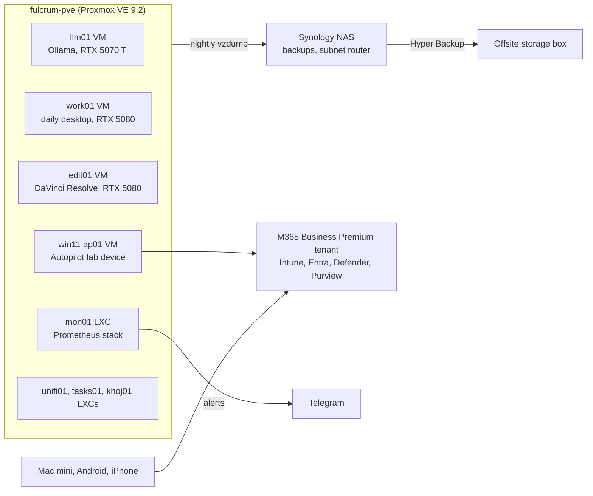

# Fulcrum homelab

A single-node Proxmox homelab and a Microsoft 365 Business Premium tenant that I build, run and break myself. The homelab is working infrastructure first: my daily desktop, local AI, video editing, monitoring and backups all run on it. The tenant is where I practise endpoint management: Intune, Entra ID, Defender and Purview.

This repo documents how it is built, what failed, how I diagnosed it, and what I changed as a result.

Snapshot: 12 October 2026.

## What this demonstrates

| Area | Evidence | Read |
|---|---|---|
| Endpoint management | Windows Autopilot (user-driven, Entra joined), compliance policies on Windows, macOS, Android and RHEL 10, silent BitLocker, Win32 app packaging with supersedence, update rings, Remediations (in progress) | [M365 and Intune labs](docs/m365-endpoint-labs.md) |
| Identity and access | Conditional Access requiring a compliant device or app protection, break-glass accounts, consent settings hardened after an accidental admin consent | [M365 and Intune labs](docs/m365-endpoint-labs.md) |
| Endpoint security | Defender for Endpoint onboarded on Windows, macOS and Android, network protection in block mode, web content filtering in Edge and Firefox | [M365 and Intune labs](docs/m365-endpoint-labs.md) |
| Data protection | Sensitivity label with encryption, DLP blocking external email, retention, eDiscovery content search | [M365 and Intune labs](docs/m365-endpoint-labs.md) |
| Virtualisation | Proxmox VE 9.2, VFIO passthrough of two GPUs and a whole USB4 controller, a hookscript that keeps two VMs off one GPU | [Architecture](docs/architecture.md) |
| Networking | Tailscale with a four-zone least-privilege ACL, subnet router, self-hosted exit nodes, tailnet-wide DNS filtering | [Networking](docs/networking.md) |
| Monitoring and backup | Prometheus, Alertmanager and blackbox_exporter on an independent drive, drive-fault detectors, dead-man's switch, automated backup-coverage check, offsite backup | [Monitoring and backups](docs/monitoring-and-backups.md) |
| Troubleshooting | Twelve written-up faults, each with the evidence that settled it | [Case studies](docs/case-studies.md) |

## Scope, stated plainly

- This is a personal lab. The tenant has one licensed user and a handful of devices. It is not fleet or production experience, and I do not describe it as such.
- Several lab endpoints are virtual machines on Proxmox. Where that affects a result, the write-up says so.
- Work in progress is marked as in progress. Open faults and known gaps are listed in the [roadmap](docs/roadmap.md).
- I worked through much of this with an AI assistant as a pair. I ran every command, made every portal change and own every decision recorded here.

## Estate at a glance

## Layout

| Path | Contents |
|---|---|
| [docs/architecture.md](docs/architecture.md) | Host, GPU and USB passthrough, storage, guests |
| [docs/networking.md](docs/networking.md) | LAN design, Tailscale ACL, DNS, mail |
| [docs/monitoring-and-backups.md](docs/monitoring-and-backups.md) | Alerting design, detectors, backup jobs, retention |
| [docs/m365-endpoint-labs.md](docs/m365-endpoint-labs.md) | Tenant labs and findings |
| [docs/case-studies.md](docs/case-studies.md) | Faults, diagnosis and outcome |
| [docs/decisions.md](docs/decisions.md) | Design decisions and the reasons for them |
| [docs/lessons.md](docs/lessons.md) | Operating principles learned the hard way |
| [docs/roadmap.md](docs/roadmap.md) | Open faults, known gaps, next work |
| [SANITISATION.md](SANITISATION.md) | What is deliberately left out of this repo, and how that is checked |
| [scripts/sanitise-check.sh](scripts/sanitise-check.sh) | Pre-publish sweep for identifiers that should not be public |

## About

Jacob Ollis. 1st Line IT Support Engineer at a Modern Workplace MSP from October 2026, building toward endpoint management and, longer term, cybersecurity. First-Class BSc in IT.

LinkedIn: https://www.linkedin.com/in/jacobollis/

## Commit conventions

Prefixes `docs:`, `scripts:`, `configs:`, `infra:`, `chore:`, `fix:`. Present tense, under 70 characters, one logical change per commit. A gitleaks pre-commit hook blocks commits containing secrets.
