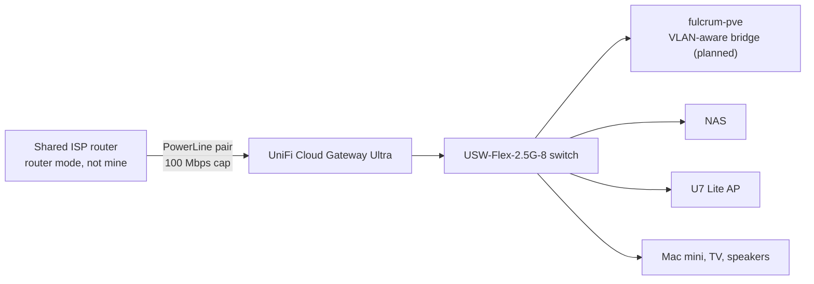

# Networking

## Edge and LAN

- Since October 2026 a **UniFi Cloud Gateway Ultra** is the router, firewall, DHCP server and DNS forwarder for the estate. It also runs UniFi Network for the switch and access point, replacing a self-hosted controller container.
- The ISP router belongs to the household, not to me, so modem mode is not an option. The gateway takes a lease from it on its WAN port. The estate sits behind **double NAT**, and everything I own is behind my own firewall. Other people's devices on the ISP router's WiFi are on the WAN side and cannot reach the estate.
- **No port forwards.** None would work through the ISP router's NAT anyway. Tailscale is the only remote access path.
- The LAN moved from the ISP router's range to a distinctive private /24. That also stops the Tailscale subnet route clashing with the default ranges found on most other networks. How the renumber was done is [case study 13](case-studies.md#13-renumbering-a-live-estate-behind-a-new-gateway).
- Infrastructure keeps a static address set on the device, in a band below the DHCP pool. Fixed-MAC clients get a DHCP reservation on the gateway, which the old ISP router could not do. Phones, watches and laptops use private MAC addresses, so they get none.
- On Ubuntu cloud images, editing netplan is not enough. Cloud-init rewrites the network config on boot unless it is disabled with a file in `/etc/cloud/cloud.cfg.d/`.

### Gateway hardening

| Setting | State | Why |
|---|---|---|
| UPnP | Off | Nothing should open ports on its own |
| Intrusion prevention | On, Notify and Block, default categories, on the Default and Lab networks | The 1 Gbps IPS ceiling costs nothing behind a 100 Mbps WAN |
| Encrypted DNS | DNS-over-HTTPS to my NextDNS profile, configured as a custom DNS stamp | LAN-only devices get the same filtering and rewrites as the tailnet |
| Content filtering and ad blocking on the gateway | Off | NextDNS already filters. Two filters in series make every blocked-site ticket twice as hard to diagnose. |
| IPv6 | Off | Prefix delegation needs modem mode, which is not available |
| Internet quality and outage logging | On by default | The evidence base for any request to replace the PowerLine link |

Proof the DNS change took effect: a lookup through the gateway returned an address that only a NextDNS rewrite knows, and the NextDNS test endpoint reported DoH with the gateway's device name.

I checked that Tailscale still makes direct connections through double NAT with IPS blocking on. An owned device pinged an exit node directly, and a phone on mobile data loaded the Proxmox UI over the subnet route.

### Known constraint: the WAN link

The wired LAN reaches the ISP router over a PowerLine adapter pair that caps out at 100 Mbps. Internal 2.5G traffic is unaffected. Internet, exit-node and offsite backup traffic are all capped.

This shapes lab design. Windows Autopilot runs here have Windows updates turned off in the Enrollment Status Page, because a cumulative update over this link could exceed the ESP timeout and a timeout looks the same as a failed deployment.

The fix is a cable run from the ISP router, which needs the household's agreement.

## Zone-based firewall and the lab VLAN

In October 2026 I upgraded the gateway from its legacy rule set to the zone-based firewall, after saving a gateway backup. The work is the first VLAN phase of a written gateway roadmap.

The first segmented network is **Lab**, for the Autopilot lab VM. It is disposable, so mistakes cost nothing. Lab has its own zone.

Built-in behaviour for a new custom zone: Lab can reach External and the Gateway, every other path in or out of Lab is blocked, and the Gateway can reach Lab.

Custom policies, evaluated before the built-ins:

| Name | Action | From | To | Protocol and port |
|---|---|---|---|---|
| Lab allow DNS | Allow | Lab | Gateway | TCP/UDP 53 |
| Lab allow DHCP | Allow | Lab | Gateway | UDP 67 |
| Lab allow ICMP to gateway | Allow | Lab | Gateway | ICMP echo request |
| Lab block gateway | Block | Lab | Gateway | All |
| Lab block ISP LAN | Block | Lab | External, the ISP router's subnet only | All |

Two design points:

- **The ISP router's LAN counts as External.** The gateway's routing table lists the ISP router's subnet as a connected network on the WAN side. Without the last policy, anything allowed to the internet could also reach the ISP router's admin page and the household's devices.
- **Internal to Lab stays blocked.** The roadmap first allowed it. Nothing on the main network needs to start a connection to the lab VM: I manage it through the Proxmox console, and Intune reaches it over the internet.

Status:

| Stage | Work | State |
|---|---|---|
| A | Lab network, Lab zone, the five policies, Lab added to IPS | Done |
| B | Make the host's bridge VLAN-aware. The switch port already trunks every VLAN. | Next |
| C | Tag the lab VM's NIC with the Lab VLAN, keeping its MAC | Planned |
| D | Boot it, confirm a Lab lease, an Intune sync and compliance, and prove that the Proxmox UI and the NAS's SMB port are unreachable from it | Planned |

One open question from Stage A: right after the network was created, with no client on it, the gateway policies counted a few hundred hits from Lab within minutes. It stopped before the flow log could name a source. The most likely explanation is the gateway's own start-up traffic on the new interface. Logging stays on for that policy until Stage D.

Later phases, in order: untrusted desktops in their own zone with only the SMB port to the NAS allowed, an IoT and guest phase, WPA2-Enterprise with the gateway's RADIUS server and dynamic VLANs delivered to a Mac through an Intune WiFi profile, and a time-boxed VPN lab that ends with every server turned off.

## Host firewalling

llm01 runs ufw with default deny inbound. Ollama's port is allowed only on the Tailscale interface and from two named LAN hosts, the monitoring container and the Khoj container. The exporters are allowed from the monitoring container only. Stable Diffusion's web API listens on all interfaces when running, and no rule opens it, so default deny keeps that unauthenticated API closed. I reach it through an SSH tunnel.

Rules are by source address. During the renumber I added each consumer's new-address rule before it moved and deleted the old one afterwards.

## Tailscale

Tailscale connects owned devices, infrastructure and a few untrusted VMs. The policy is default deny with four zones.

| Zone | Who is in it |
|---|---|
| `autogroup:member` | My personal devices, untagged |
| `tag:infra` | Proxmox host, NAS, llm01, monitoring and task containers |
| `tag:untrusted` | work01 and edit01, the VMs where I browse and install desktop software |
| `tag:exit-node` | Three self-hosted exit nodes on European VPS providers |

### Grants

| # | From | To | Ports | Purpose |
|---|---|---|---|---|
| 1 | members | `tag:infra`, `tag:untrusted` | all | Manage infrastructure and lab VMs from my own devices |
| 2 | members | home subnet via the NAS | all | Reach LAN-only services remotely |
| 3 | members | internet | all | Exit-node use |
| 4 | `tag:untrusted` | internet | all | Untrusted VMs get internet only |
| 5 | NAS | members | Syncthing | NAS starts sync to my devices |
| 6 | work01 | Mac mini | one TCP port | One desktop app to one relay service, scoped to two named hosts |
| 7 | work01 | NAS | Syncthing | Vault sync from the work desktop |

Design points:

- **No grant lets infrastructure reach other infrastructure.** A compromised container cannot use the tailnet to move sideways. This has a cost I accept: the monitoring container cannot reach the NAS by its tailnet address, so its certificate probe resolves the NAS through a local hosts entry instead.
- **Untrusted VMs get internet only,** plus two grants scoped to named hosts. Grants 6 and 7 use aliases in the policy's `hosts` block mapped to stable tailnet addresses, rather than tags.
- **work01 stays tagged on purpose.** Untagged, it would join `autogroup:member` and gain full reach into infrastructure under grant 1. A Tailscale device loses member status the moment it carries any tag, so tagging is how its reach is cut down.
- **No auth keys or API tokens exist** on the tailnet.
- **Key expiry is on for personal devices,** so a lost device stops working without manual removal. It is off for tagged infrastructure and for one always-on server, by decision.
- During the renumber, the new subnet route was added beside the old one in the grant and the auto-approver, and the old one removed only after every check passed.

Known weaknesses, recorded rather than hidden:

- The auto-approver for the home subnet route approves it for any `tag:infra` node, not only the NAS. It matters only after an infra node is compromised. The fix is a dedicated tag for the subnet router.
- An SSH rule to the exit nodes has no matching network grant, so it is probably inert. To be tested and either fixed or deleted.
- UniFi's brokered VPN, Teleport, was found enabled on the gateway. No standing VPN server belongs outside the VPN lab, so it is to be turned off.

Two Tailscale behaviours that cost me time:

- `tailscale ping` bypasses ACL grants. It proves the path exists, not that an application can connect.
- A guest firewall allowing a port does not make it reachable over the tailnet. The ACL is a separate default-deny layer. When a service is listening and the guest firewall is open but a tailnet client times out, check the grant first.

## DNS

- NextDNS is set as the tailnet's global nameserver over DNS-over-HTTPS, and the gateway forwards LAN queries to the same profile over DoH. Blocklist HaGeZi Pro++, plus threat intelligence, cryptojacking and disguised-tracker blocking.
- NextDNS rewrites give internal names to the Proxmox and NAS web interfaces. The public DNS zone holds no record for any private address.
- On Android, Defender for Endpoint's web protection runs as a local VPN, and Android allows one active VPN. I turned Defender's web protection off by app configuration so Tailscale can run, and NextDNS is the compensating web filter.
- An active exit node changes the DNS path. I check exit-node state before diagnosing any DNS problem.

## Mail and DNS hosting for the tenant domain

- The tenant's custom domain uses Exchange Online. The registrar is separate from the authoritative DNS host, which is Cloudflare.
- MX, SPF, autodiscover, DKIM (two selectors) and DMARC are published and verified from the receiving side: `spf=pass`, `dkim=pass` and `dmarc=pass` in the receiver's `Authentication-Results` header.
- DMARC is at `p=none`, collecting aggregate reports. Moving to quarantine is blocked on one known sender: Proxmox sends notification mail from a subdomain that is not an authorised sender. With no `sp=` tag the subdomain inherits the parent policy, so quarantine would send every backup report to spam. That gets fixed first.
- Certificate DNS challenges use separate API tokens per host where that is done. The Proxmox host has its own token, scoped to one zone with DNS edit and zone read. The NAS still shares an older token, which is on the roadmap.

These records were missing for a while. See [case study 8](case-studies.md#8-a-mail-outage-found-by-someone-else).
