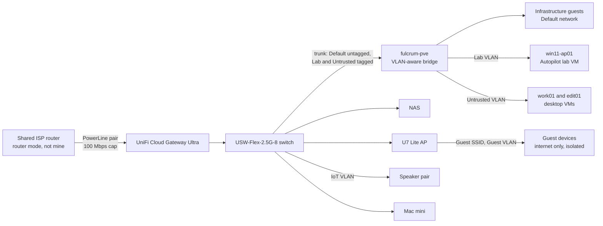

# Networking

## Edge and LAN

- Since October 2026 a **UniFi Cloud Gateway Ultra** is the router, firewall, DHCP server and DNS forwarder for the estate. It also runs UniFi Network for the switch and access point, replacing a self-hosted controller container.
- The ISP router belongs to the household, not to me, so modem mode is not an option. The gateway takes a lease from it on its WAN port. The estate sits behind **double NAT**, and everything I own is behind my own firewall. Other people's devices on the ISP router's WiFi are on the WAN side and cannot reach the estate.
- **No port forwards.** None would work through the ISP router's NAT anyway. Tailscale is the only remote access path.
- The LAN moved from the ISP router's range to a distinctive private /24. That also stops the Tailscale subnet route clashing with the default ranges found on most other networks. How the renumber was done is [case study 13](case-studies.md#13-renumbering-a-live-estate-behind-a-new-gateway).
- Infrastructure keeps a static address set on the device, in a band below the DHCP pool. Fixed-MAC clients get a DHCP reservation on the gateway, which the old ISP router could not do. Phones, watches and laptops use private MAC addresses, so they get none.
- On Ubuntu cloud images, editing netplan is not enough. Cloud-init rewrites the network config on boot unless it is disabled with a file in `/etc/cloud/cloud.cfg.d/`.

### Gateway hardening

| Setting | State | Why |
|---|---|---|
| UPnP | Off | Nothing should open ports on its own |
| Intrusion prevention | On, Notify and Block, default categories, on the Default, Lab, Untrusted, IoT and Guest networks | The 1 Gbps IPS ceiling costs nothing behind a 100 Mbps WAN |
| Encrypted DNS | DNS-over-HTTPS to my NextDNS profile, configured as a custom DNS stamp | LAN-only devices get the same filtering and rewrites as the tailnet |
| Content filtering and ad blocking on the gateway | Off | NextDNS already filters. Two filters in series make every blocked-site ticket twice as hard to diagnose. |
| IPv6 | Off | Prefix delegation needs modem mode, which is not available |
| mDNS proxy | Custom: main and IoT networks only, one service only | On Auto it reflected every network's service announcements into the lab VLAN ([case study 16](case-studies.md#16-the-gateway-announced-the-estate-into-the-lab)). It was Off until the speakers needed it, then scoped as tightly as the app allows ([case study 18](case-studies.md#18-a-speaker-pair-behind-a-firewall-designed-from-a-capture)). |
| Teleport (UniFi's brokered VPN) | Off | Found enabled. Tailscale is the only remote access path. |
| Internet quality and outage logging | On by default | The evidence base for any request to replace the PowerLine link |

Proof the DNS change took effect: a lookup through the gateway returned an address that only a NextDNS rewrite knows, and the NextDNS test endpoint reported DoH with the gateway's device name.

I checked that Tailscale still makes direct connections through double NAT with IPS blocking on. An owned device pinged an exit node directly, and a phone on mobile data loaded the Proxmox UI over the subnet route.

### Known constraint: the WAN link

The wired LAN reaches the ISP router over a PowerLine adapter pair that caps out at 100 Mbps. Internal 2.5G traffic is unaffected. Internet, exit-node and offsite backup traffic are all capped.

This shapes lab design. Windows Autopilot runs here have Windows updates turned off in the Enrollment Status Page, because a cumulative update over this link could exceed the ESP timeout and a timeout looks the same as a failed deployment.

The fix is a cable run from the ISP router, which needs the household's agreement.

## Zone-based firewall and the lab VLAN

In October 2026 I upgraded the gateway from its legacy rule set to the zone-based firewall, after saving a gateway backup. The work is the first VLAN phase of a written gateway roadmap.

The first segmented network is **Lab**, for the Autopilot lab VM. It is disposable, so mistakes cost nothing. Lab has its own zone.

Built-in behaviour for a new custom zone: Lab can reach External and the Gateway, every other path in or out of Lab is blocked, and the Gateway can reach Lab.

Custom policies, evaluated before the built-ins:

| Name | Action | From | To | Protocol and port |
|---|---|---|---|---|
| Lab allow DNS | Allow | Lab | Gateway | TCP/UDP 53 |
| Lab allow DHCP | Allow | Lab | Gateway | UDP 67 |
| Lab allow ICMP to gateway | Allow | Lab | Gateway | ICMP echo request |
| Lab block gateway | Block | Lab | Gateway | All |
| Lab block ISP LAN | Block | Lab | External, the ISP router's subnet only | All |

Two design points:

- **The ISP router's LAN counts as External.** The gateway's routing table lists the ISP router's subnet as a connected network on the WAN side. Without the last policy, anything allowed to the internet could also reach the ISP router's admin page and the household's devices.
- **Internal to Lab stays blocked.** The roadmap first allowed it. Nothing on the main network needs to start a connection to the lab VM: I manage it through the Proxmox console, and Intune reaches it over the internet.

Status:

| Stage | Work | State |
|---|---|---|
| A | Lab network, Lab zone, the five policies, Lab added to IPS | Done |
| B | Make the host's bridge VLAN-aware. The switch port already trunks every VLAN. | Done |
| C | Tag the lab VM's NIC with the Lab VLAN, keeping its MAC | Done |
| D | Boot it and prove the policies | Done |

Stage B was a two-line change to the bridge stanza, made at the console after a backup, with the stanza checked before `ifreload`. The host kept its address, and every guest answered afterwards. The VM's own tap port now carries only the Lab VLAN, untagged.

Stage D evidence, all from the lab VM:

| Test | Expected | Result |
|---|---|---|
| DHCP lease | Lab subnet | Leased, gateway on the Lab subnet |
| Ping to the gateway | Allowed by the ICMP policy | 3 of 3 |
| DNS through the gateway | Allowed | Microsoft sign-in name resolved |
| TCP 443 to Microsoft sign-in | Allowed (internet) | Succeeded |
| TCP 8006 to the Proxmox UI | Blocked (Internal) | Failed |
| TCP 445 to the NAS | Blocked (Internal) | Failed |
| TCP 443 to the gateway | Blocked (Gateway) | Failed |
| TCP 80 to the ISP router | Blocked (ISP LAN) | Failed |
| Intune | Syncs and stays compliant | Checked in, Compliant, 12 of 12 configuration and 2 of 2 compliance settings succeeded |

Ping to the gateway succeeded while TCP 443 to the same address failed. That shows a policy decision, not a routing fault. The policy counters moved with each test.

The lab VM now has a DHCP reservation on the Lab network. Its logging was turned off once the tests were done.

One question stays open. The Lab-to-Gateway block policy counts about 60 hits a minute even with the lab VM shut down. A packet capture on the host trunk showed only the gateway itself sending on that VLAN: IGMP and UniFi discovery traffic. The counter is most likely the gateway's own traffic on the Lab interface. That is not proven, and it is recorded as an open question rather than an answer. How the capture also found the mDNS problem is [case study 16](case-studies.md#16-the-gateway-announced-the-estate-into-the-lab).

## Untrusted zone for the desktop VMs

The second segmented network holds the two desktop VMs, work01 and edit01. They are where I browse and install desktop software, and they already carry `tag:untrusted` on the tailnet. The Untrusted zone brings the LAN in line with that.

| Name | Action | To | Protocol and port |
|---|---|---|---|
| Untrusted allow DNS | Allow | Gateway | TCP/UDP 53 |
| Untrusted allow DHCP | Allow | Gateway | UDP 67 |
| Untrusted allow ICMP to gateway | Allow | Gateway | ICMP echo request |
| Untrusted block gateway | Block | Gateway | All |
| Untrusted allow NAS SMB | Allow, with return traffic | Internal, the NAS only | TCP 445 |
| Untrusted allow Tailscale direct | Allow, with return traffic | Internal, the NAS and the Mac mini only | UDP 41641 |
| Untrusted block ISP LAN | Block | External, the ISP router's subnet only | All |
| Untrusted block Discord | Block | External, the Discord application | All |

Design points:

- **Return traffic has to be allowed explicitly.** Internal to Untrusted is blocked. Without the return-traffic option on the SMB policy, the NAS's replies would meet that block and the mount would hang rather than fail.
- **The Tailscale policy was not in the plan.** I expected Tailscale to be unaffected because it leaves through the WAN. It was affected. See [case study 17](case-studies.md#17-segmentation-that-quietly-sent-lan-traffic-to-london).
- **Block, not Reject, for Discord.** Block drops silently, so the page spins. That hides the policy from a probe, at the cost of a less clear experience for the user. In a client setting I would choose Reject, or a block page, so a user knows it is deliberate.
- **The host's backups are unaffected.** The host stays on the Default network, so backup traffic never crosses the gateway. Only work01's file share traffic now routes through the gateway and its IPS.

Evidence from work01 after the move:

| Test | Expected | Result |
|---|---|---|
| File share mount | Allowed (SMB to the NAS) | Lists |
| Syncthing to the NAS | Allowed, over Tailscale | Connected, up to date |
| Message relay to the Mac mini | Allowed, over Tailscale | Sent and received |
| Tailscale paths to the NAS and Mac mini | Direct | Direct, 1 ms and 7 ms |
| SSH to llm01 | Blocked | Failed |
| NAS admin UI | Blocked | Failed |
| SMB to the NAS, same test method | Allowed | Opened, the positive control |
| discord.com | Blocked by the application policy | Never loaded, policy counter at 140 |

edit01 is tagged onto the network but not yet tested on it. Its boot currently stalls at a text cursor before the login screen, which is on the roadmap.

## IoT zone for the speaker pair

The third segmented network holds a wired stereo speaker pair. Speakers are the classic IoT problem: the phone app discovers them by multicast, which does not cross a router, and vendors rarely document what their app needs. Sonos's own staff advise keeping the app and speakers on one subnet. I set a fallback before starting: if the app could not control the speakers from the main network, they would go back and the IoT network would stay empty.

| Name | Action | From | To | Protocol and port |
|---|---|---|---|---|
| Default allow Sonos control | Allow, with return traffic | Internal | The two speakers only | TCP 1443 |
| IoT allow DNS | Allow | IoT | Gateway | TCP/UDP 53 |
| IoT allow DHCP | Allow | IoT | Gateway | UDP 67 |
| IoT allow mDNS to gateway | Allow | IoT | Gateway | UDP 5353 |
| IoT allow ICMP to gateway | Allow | IoT | Gateway | ICMP echo request |
| IoT block gateway | Block | IoT | Gateway | All |
| IoT block ISP LAN | Block | IoT | External, the ISP router's subnet only | All |

Design points:

- **One control port, found by asking the speaker.** The vendor's firewall article lists many ports and says nothing about which side connects. A query straight to a speaker's mDNS responder returned its service record: control is TLS on TCP 1443, from the app to the speaker. That is the only port allowed in. A test from the host showed 1443 open and the speaker's older HTTP port blocked.
- **The mDNS allow sits above the gateway block.** The proxy needs the speakers' announcements. My custom block on the Gateway zone would otherwise shadow the built-in mDNS allow.
- **The IoT zone cannot start anything toward the main network.** The only path across is the app connecting in, with replies allowed back.
- **AirPlay is off, by decision.** AirPlay announces a different service, outside the proxy scope, and AirPlay 2 needs a further port plus a range of dynamic ones from the main network into IoT. The Sonos app is enough.
- **DHCP guarding needed a fix.** The new-network form pre-filled the gateway's factory LAN address as the trusted DHCP server. With guarding on, that would have dropped the gateway's own offers on the new network. Corrected before any device joined.

Evidence, with the phone on the main network and Tailscale off:

| Test | Expected | Result |
|---|---|---|
| App finds the speaker pair after a relaunch | Through the mDNS proxy | Found |
| Play, pause and volume, both channels | Allowed on TCP 1443 | Worked. The control policy counted 160 hits, which only real client traffic can produce. |
| TCP 1443 to a speaker from the host | Allowed | Open |
| The speaker's HTTP port from the host | Blocked | Blocked |
| Speaker records reaching Lab or Untrusted | None | Captures on both showed only their baseline, before and after the move |
| AirPlay from another app | Not offered | Not offered |
| IoT to the ISP router's subnet | Blocked | No attempts |

Two smaller unknowns, recorded rather than guessed: the speakers try some gateway service beyond DNS, DHCP and mDNS (NTP is the likeliest), and they made three attempts toward the main network. Neither is visible from the host's switch port, so naming them waits for a syslog receiver.

## Guest network

The last network in this phase is for visitors: internet only, nothing else, and no guest able to reach another.

- **UniFi's built-in Hotspot zone, not a custom zone.** Once a network joins it, UniFi adds the zone's own guest rules. One of them, `Post-Authorization Restrictions`, already blocks every private range, which covers the ISP router's LAN. The custom block I had planned would have duplicated it, so I wrote no custom policies at all. I read the zone's rules again after the network existed, because before that it showed only a default block.
- **A WPA2/WPA3 SSID with client isolation, no captive portal.** The form defaulted to a captive portal. Switching it off silently reset the security protocol to WPA2 only, which I caught on a full reread of the form and set back.
- **An empty switch port set to the Guest network,** so anything plugged into it lands on guest. The plan named one port; the live port list showed my notes had two ports swapped, and that port carried the Mac mini. I changed the port the live list showed empty.

Evidence, from a laptop on the guest SSID with Tailscale quit, so the subnet route could not stand in for the LAN:

| Test | Expected | Result |
|---|---|---|
| A public website over HTTPS | Allowed | Loaded |
| DNS through the guest gateway | Allowed | Answered |
| NAS file share and admin UI | Blocked | Timed out |
| Gateway admin on the main network and on the guest network | Blocked | Timed out |
| The ISP router's admin page | Blocked | Timed out |
| A speaker's control port on the IoT network | Blocked | Timed out |
| Apple's captive portal check | No portal | Success |
| Ping between two guest clients | Blocked by isolation | 0 of 3 |
| The same two clients on the main network | Allowed, the positive control | 3 of 3 |

Three things stay open, all low priority. Ping to the guest gateway fails although the built-in rule allows it. The zone's hit counters do not match the tests: the rules aimed at the private ranges stayed at zero while a different built-in rule counted thousands. And the wired path on the guest port is untested. The portal listener on the gateway answers guests with an HTTP error even with no portal enabled; I accepted that rather than block it, since a future portal would need it. See [case study 20](case-studies.md#20-a-guest-network-that-needed-no-custom-rules).

Later phases, in order: WPA2-Enterprise with the gateway's RADIUS server and dynamic VLANs delivered to a Mac through an Intune WiFi profile, and a time-boxed VPN lab that ends with every server turned off.

## Host firewalling

llm01 runs ufw with default deny inbound. Ollama's port is allowed only on the Tailscale interface and from two named LAN hosts, the monitoring container and the Khoj container. The exporters are allowed from the monitoring container only. Stable Diffusion's web API listens on all interfaces when running, and no rule opens it, so default deny keeps that unauthenticated API closed. I reach it through an SSH tunnel.

Rules are by source address. During the renumber I added each consumer's new-address rule before it moved and deleted the old one afterwards.

## Tailscale

Tailscale connects owned devices, infrastructure and a few untrusted VMs. The policy is default deny with four zones.

| Zone | Who is in it |
|---|---|
| `autogroup:member` | My personal devices, untagged |
| `tag:infra` | Proxmox host, NAS, llm01, monitoring and task containers |
| `tag:untrusted` | work01 and edit01, the VMs where I browse and install desktop software |
| `tag:exit-node` | Three self-hosted exit nodes on European VPS providers |

### Grants

| # | From | To | Ports | Purpose |
|---|---|---|---|---|
| 1 | members | `tag:infra`, `tag:untrusted` | all | Manage infrastructure and lab VMs from my own devices |
| 2 | members | home subnet via the NAS | all | Reach LAN-only services remotely |
| 3 | members | internet | all | Exit-node use |
| 4 | `tag:untrusted` | internet | all | Untrusted VMs get internet only |
| 5 | NAS | members | Syncthing | NAS starts sync to my devices |
| 6 | work01 | Mac mini | one TCP port | One desktop app to one relay service, scoped to two named hosts |
| 7 | work01 | NAS | Syncthing | Vault sync from the work desktop |

Design points:

- **No grant lets infrastructure reach other infrastructure.** A compromised container cannot use the tailnet to move sideways. This has a cost I accept: the monitoring container cannot reach the NAS by its tailnet address, so its certificate probe resolves the NAS through a local hosts entry instead.
- **Untrusted VMs get internet only,** plus two grants scoped to named hosts. On the LAN they sit in the matching Untrusted firewall zone, which allows Tailscale packets only to the same two hosts. Grants 6 and 7 use aliases in the policy's `hosts` block mapped to stable tailnet addresses, rather than tags.
- **work01 stays tagged on purpose.** Untagged, it would join `autogroup:member` and gain full reach into infrastructure under grant 1. A Tailscale device loses member status the moment it carries any tag, so tagging is how its reach is cut down.
- **No auth keys or API tokens exist** on the tailnet.
- **Key expiry is on for personal devices,** so a lost device stops working without manual removal. It is off for tagged infrastructure and for one always-on server, by decision.
- During the renumber, the new subnet route was added beside the old one in the grant and the auto-approver, and the old one removed only after every check passed.

Known weaknesses, recorded rather than hidden:

- The auto-approver for the home subnet route approves it for any `tag:infra` node, not only the NAS. It matters only after an infra node is compromised. The fix is a dedicated tag for the subnet router.
- An SSH rule to the exit nodes has no matching network grant, so it is probably inert. To be tested and either fixed or deleted.

Two Tailscale behaviours that cost me time:

- `tailscale ping` bypasses ACL grants. It proves the path exists, not that an application can connect.
- A guest firewall allowing a port does not make it reachable over the tailnet. The ACL is a separate default-deny layer. When a service is listening and the guest firewall is open but a tailnet client times out, check the grant first.

## DNS

- NextDNS is set as the tailnet's global nameserver over DNS-over-HTTPS, and the gateway forwards LAN queries to the same profile over DoH. Blocklist HaGeZi Pro++, plus threat intelligence, cryptojacking and disguised-tracker blocking.
- NextDNS rewrites give internal names to the Proxmox and NAS web interfaces. The public DNS zone holds no record for any private address.
- On Android, Defender for Endpoint's web protection runs as a local VPN, and Android allows one active VPN. I turned Defender's web protection off by app configuration so Tailscale can run, and NextDNS is the compensating web filter.
- An active exit node changes the DNS path. I check exit-node state before diagnosing any DNS problem.

## Mail and DNS hosting for the tenant domain

- The tenant's custom domain uses Exchange Online. The registrar is separate from the authoritative DNS host, which is Cloudflare.
- MX, SPF, autodiscover, DKIM (two selectors) and DMARC are published and verified from the receiving side: `spf=pass`, `dkim=pass` and `dmarc=pass` in the receiver's `Authentication-Results` header.
- DMARC is at `p=none`, collecting aggregate reports. Moving to quarantine is blocked on one known sender: Proxmox sends notification mail from a subdomain that is not an authorised sender. With no `sp=` tag the subdomain inherits the parent policy, so quarantine would send every backup report to spam. That gets fixed first.
- Certificate DNS challenges use separate API tokens per host where that is done. The Proxmox host has its own token, scoped to one zone with DNS edit and zone read. The NAS still shares an older token, which is on the roadmap.

These records were missing for a while. See [case study 8](case-studies.md#8-a-mail-outage-found-by-someone-else).
